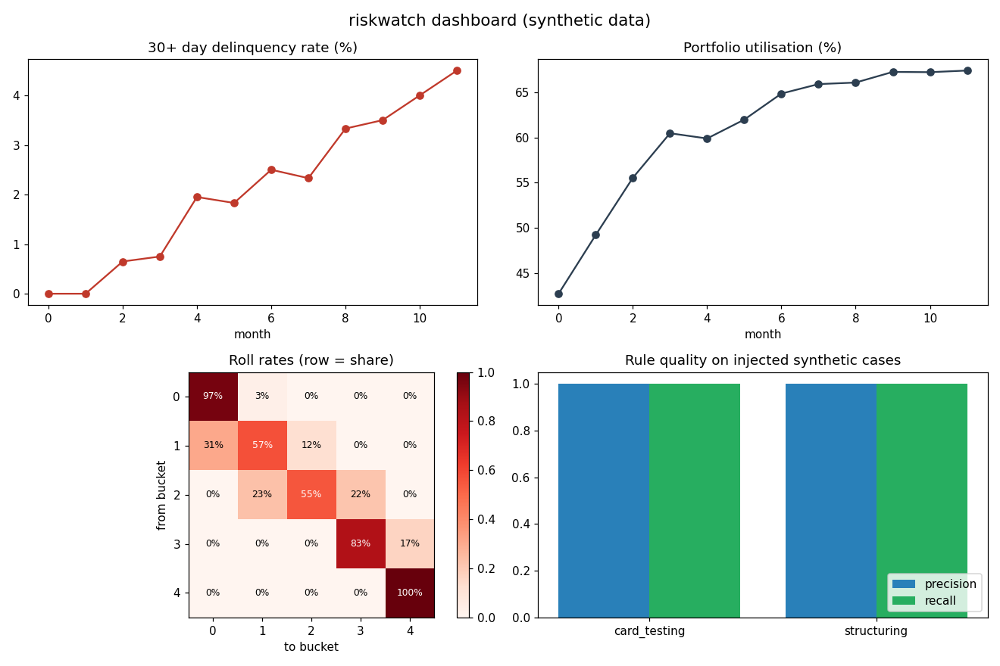

# riskwatch

A small credit, fraud and AML monitoring pipeline on **synthetic data**. I built it as a learning project for a junior data analyst role in a card-and-risk team: SQL for the metrics, Python to run and report, tests for the rules.



## What it does

1. `generate.py` creates 600 fictional small-business card customers, about 12 months of transactions, and monthly account snapshots (balance, days-past-due bucket).
2. `db.py` loads everything into SQLite.
3. `sql/` holds the metric and rule queries (joins, CTEs, window functions):
   - `portfolio_monthly.sql` - balance, utilisation, 30+ day delinquency rate by month
   - `roll_rates.sql` - how accounts move between delinquency buckets month to month
   - `segment_risk.sql` - risk by customer segment
   - `fraud_card_testing.sql` - rule: 5+ transactions under 5.00 within an hour
   - `aml_structuring.sql` - rule: 3+ transactions of 9,000-9,999.99 within 7 days
4. `rules.py` scores each rule against the cases injected into the data (precision, recall).
5. `report.py` builds the dashboard, a plain-text summary written from the numbers, and a prompt builder that shows how to hand only aggregate figures to an LLM.

## Run it

```bash
pip install -r requirements.txt
PYTHONPATH=src python -m riskwatch.cli --out out
PYTHONPATH=src python -m pytest -q
```

Output: CSVs, `summary.txt` and `dashboard.png` in `out/`. Same seed gives the same data.

## Honest scope

- All data is made up. The patterns (card testing, structuring) are injected by me, so **the 100% precision and recall are not a result**. They only show the rules match the patterns I wrote. Real data is messier and the rules would need tuning against false positives.
- Delinquency and payment behaviour come from a simple random model with one hidden risk factor. Numbers such as the delinquency trend are illustrative, not a model of a real portfolio.
- The 10,000 threshold is an example parameter, not a claim about a specific regulation.
- No machine learning model and no live LLM call. `llm_prompt()` only builds the prompt; a person would have to review any generated text.
- Not production code: no scheduling, no data-quality monitoring, no access control.

See `STUDY_GUIDE.md` for how each part works and likely interview questions.
